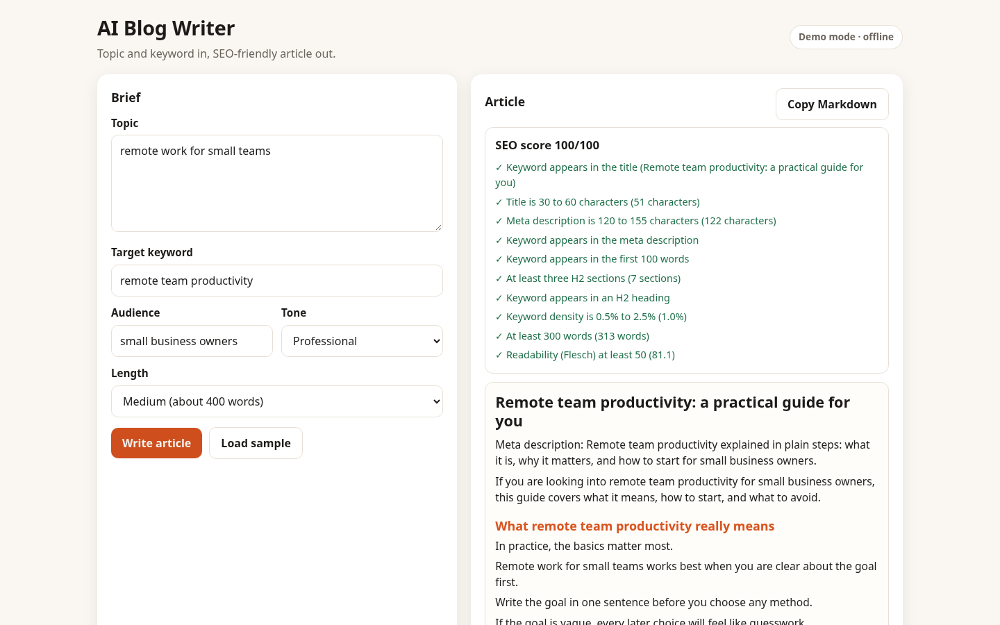

# AI Blog Writer

Turn a topic and a target keyword into an SEO-friendly blog article, then check it against an SEO scorecard. Works offline; point it at any OpenAI-compatible model for richer writing.



## What it does

- Brief form: topic, target keyword, audience, tone (Friendly, Professional, Expert, Playful) and length
- Article draft in Markdown: keyword-aware H1 title, meta description, intro, H2 sections, a 3-question FAQ and a wrap-up
- Built-in SEO scorecard with 10 checks: title and meta length, keyword placement, subheadings, keyword density, length and readability
- Copy the Markdown with one click
- Live mode: the same brief goes to your own model with a strict format prompt, and the scorecard checks the result

## Modes

- **Demo mode (default, offline):** a template-based article built from your brief. It is not a language model: the sentences are deliberately generic, so treat it as a skeleton to rewrite, and use live mode when you want fluent prose.
- **Live mode (optional):** your OpenAI-compatible chat endpoint writes the article from the same brief; the scorecard then checks that output.

Settings (API base URL, key, model and the live switch) live in the collapsible Settings panel. They are stored only in this browser's `localStorage` and are sent only to the base URL you enter. Nothing is committed to the repo.

## Quick start

```bash
git clone https://github.com/connectnived-lab/ai-blog-writer.git
cd ai-blog-writer
python3 -m http.server 8000
# open http://localhost:8000
```

No build step and no runtime npm dependencies: it is plain HTML, CSS and ES modules.


## Tests

```bash
npm test          # node:test unit tests (core logic, the LLM client with a mocked fetch, the shared helpers)
npm run e2e       # Playwright smoke test: 390x844 and 1440x900, demo mode and mocked live mode, console errors, horizontal scroll
```

`npm test` runs 71 unit tests covering brief validation, article structure for every tone and length, the SEO scorecard (including failure cases), the prompt builder, the Markdown renderer and the LLM client's error paths. `npm run e2e` runs 20 browser checks across both viewports, both modes, and asserts there are no console errors and no horizontal scroll.

The end-to-end script uses the local Chromium through Python Playwright (`pip install playwright && python3 -m playwright install chromium`).

## Layout

```
src/core/      pure logic (no DOM): the features the tests cover
src/shared/    config, OpenAI-compatible client, text helpers, Markdown renderer
src/ui/        DOM only: settings panel and shared UI helpers
src/app.js     wires the UI to the core
tests/unit/    node:test suites
tests/e2e/     Playwright smoke test (python)
docs/          real screenshots
showcase/      portfolio write-up and cover image
```

## Limitations

- Demo articles are template text. They are useful for structure and SEO checks, not for publishing unedited.
- The scorecard is a set of heuristics (keyword density, sentence length, Flesch reading ease). It does not measure search ranking.
- Live mode trusts the model's output; the scorecard flags problems but does not fact-check claims.
- Nothing is sent anywhere except the endpoint you configure.

## Licence and credit

MIT License, Copyright (c) 2026 Nived NS. See [LICENSE](LICENSE).

Created and owned by Nived NS - https://github.com/connectnived-lab
